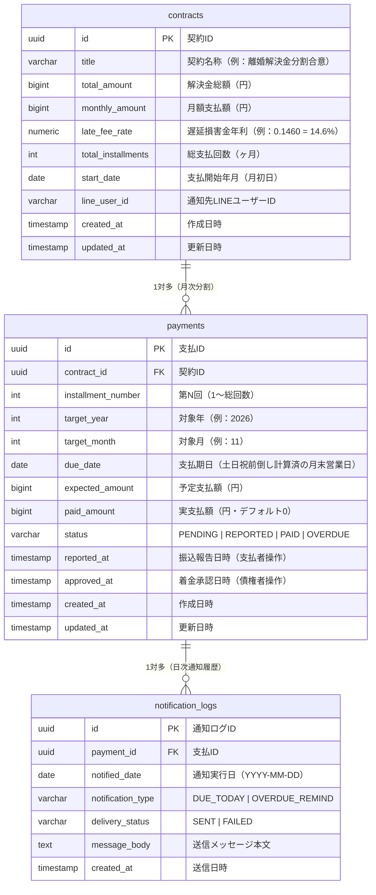
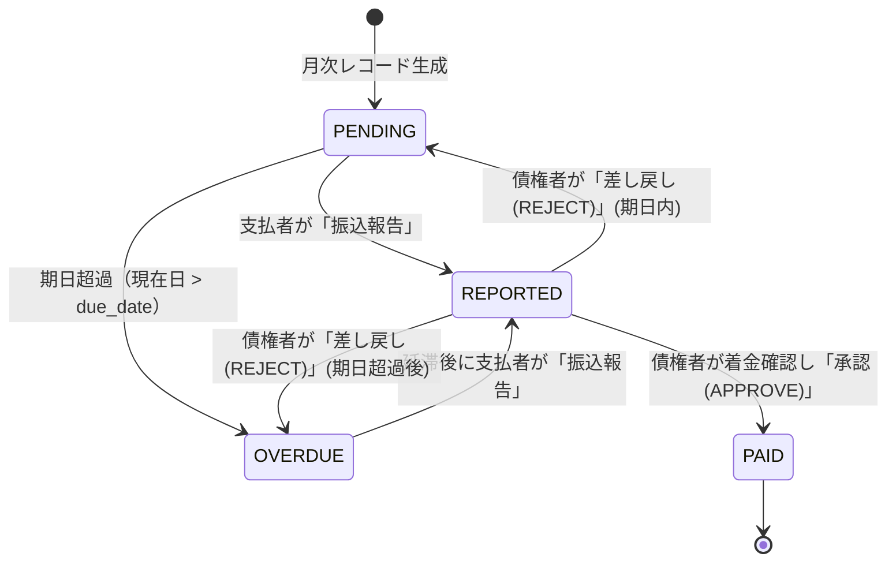

# システム基本設計書（DB・API・画面仕様・エッジケース定義）

関連Issue: `#1`

本ドキュメントでは、MVP開発におけるデータ構造（DB）、APIインターフェース、画面ワイヤーフレーム、およびエッジケース（営業日計算・ステータス遷移・二重通知防止）の仕様を定義する。

---

## 1. DB設計（ER図・テーブル定義）

### 1.1 ER図



---

### 1.2 テーブル定義・制約

#### ① `contracts`（契約マスタ）
契約全体の基本条件を保持するテーブル。

| カラム名 | データ型 | NULL | デフォルト | 制約・説明 |
| :--- | :--- | :--- | :--- | :--- |
| `id` | `UUID` | NO | `gen_random_uuid()` | PRIMARY KEY |
| `title` | `VARCHAR(255)` | NO | - | 契約タイトル（例：`離婚解決金支払合意書`） |
| `total_amount` | `BIGINT` | NO | - | `CHECK (total_amount > 0)` 総額（円） |
| `monthly_amount` | `BIGINT` | NO | - | `CHECK (monthly_amount > 0)` 月々の支払額（円） |
| `late_fee_rate` | `NUMERIC(5, 4)` | NO | `0.1460` | 遅延損害金年利率（デフォルト年14.6% = `0.1460`） |
| `total_installments` | `INT` | NO | - | `CHECK (total_installments > 0)` 総支払回数 |
| `start_date` | `DATE` | NO | - | 初回支払対象月の1日 |
| `line_user_id` | `VARCHAR(128)` | YES | `NULL` | LINE Messaging API 送信先UserID |
| `created_at` | `TIMESTAMPTZ` | NO | `NOW()` | 作成日時 |
| `updated_at` | `TIMESTAMPTZ` | NO | `NOW()` | 更新日時 |

#### ② `payments`（月次支払い履歴・ステータス）
各月の支払期日と入金・承認ステータスを管理するテーブル。

| カラム名 | データ型 | NULL | デフォルト | 制約・説明 |
| :--- | :--- | :--- | :--- | :--- |
| `id` | `UUID` | NO | `gen_random_uuid()` | PRIMARY KEY |
| `contract_id` | `UUID` | NO | - | FOREIGN KEY (`contracts.id`) ON DELETE CASCADE |
| `installment_number` | `INT` | NO | - | 第N回支払（`1`〜`total_installments`） |
| `target_year` | `INT` | NO | - | 対象年（例：`2026`） |
| `target_month` | `INT` | NO | - | `CHECK (target_month BETWEEN 1 AND 12)` |
| `due_date` | `DATE` | NO | - | **月末営業日ロジックで算出された支払期日** |
| `expected_amount` | `BIGINT` | NO | - | 当月の請求元本（円） |
| `paid_amount` | `BIGINT` | NO | `0` | 承認済みの支払額（円） |
| `status` | `VARCHAR(32)` | NO | `'PENDING'` | `'PENDING'`, `'REPORTED'`, `'PAID'`, `'OVERDUE'` |
| `reported_at` | `TIMESTAMPTZ` | YES | `NULL` | 支払者が「振込完了報告」を行った日時 |
| `approved_at` | `TIMESTAMPTZ` | YES | `NULL` | 債権者が「着金確認・承認」を行った日時 |
| `created_at` | `TIMESTAMPTZ` | NO | `NOW()` | 作成日時 |
| `updated_at` | `TIMESTAMPTZ` | NO | `NOW()` | 更新日時 |

* **複合ユニーク制約**: `UNIQUE (contract_id, target_year, target_month)` （同一契約で同じ年月のレコード重複を防止）

#### ③ `notification_logs`（通知履歴・二重送信防止テーブル）
CronバッチによるLINE通知の送信履歴を記録し、**同日の二重通知（冪等性）をDBレベルで担保**するテーブル。

| カラム名 | データ型 | NULL | デフォルト | 制約・説明 |
| :--- | :--- | :--- | :--- | :--- |
| `id` | `UUID` | NO | `gen_random_uuid()` | PRIMARY KEY |
| `payment_id` | `UUID` | NO | - | FOREIGN KEY (`payments.id`) ON DELETE CASCADE |
| `notified_date` | `DATE` | NO | - | 通知実行日（JSTの `YYYY-MM-DD`） |
| `notification_type` | `VARCHAR(32)` | NO | - | `'DUE_TODAY'`（期日当日） / `'OVERDUE_REMIND'`（延滞督促） |
| `delivery_status` | `VARCHAR(32)` | NO | `'SENT'` | `'SENT'`（送信成功） / `'FAILED'`（送信失敗） |
| `message_body` | `TEXT` | NO | - | 実際に送信したメッセージ内容 |
| `created_at` | `TIMESTAMPTZ` | NO | `NOW()` | 作成日時 |

* **複合ユニーク制約（冪等性の要）**: `UNIQUE (payment_id, notified_date, notification_type)`
  * 万が一Cronバッチが同日に複数回実行されても、同一支払に対する同日の同じ通知種別はDB制約により二重登録・二重送信されない。

---

## 2. API設計（エンドポイント一覧）

ベースパス: `/api/v1`

| メソッド | パス | 概要 | 実行主体 |
| :--- | :--- | :--- | :--- |
| `GET` | `/api/v1/contracts/:id/summary` | ダッシュボード用の進捗サマリー・当月ステータス・支払履歴一覧を取得 | Frontend |
| `POST` | `/api/v1/payments/:id/report` | 支払者が「振込完了」を報告する（`PENDING`/`OVERDUE` → `REPORTED`） | Frontend (支払者) |
| `PATCH` | `/api/v1/payments/:id/approve` | 債権者が着金を確認し「承認」または「差し戻し」を行う | Frontend (債権者) |
| `POST` | `/api/v1/batch/notify` | 当日が期日または延滞中の支払いを検知し、LINE催促通知を送信する | GitHub Actions (Cron) |

---

### 2.1 `GET /api/v1/contracts/:id/summary`（サマリー取得）

> **契約条件（実データ基準）**: 令和8年（2026年）3月末日〜令和9年（2027年）10月末日まで、毎月末日10万円（全20回・総額200万円）

#### Response (`200 OK`)
```json
{
  "contract": {
    "id": "c1a2b3c4-0000-4000-8000-000000000001",
    "title": "離婚解決金分割支払合意（令和8年3月〜令和9年10月）",
    "total_amount": 2000000,
    "monthly_amount": 100000,
    "paid_total_amount": 800000,
    "remaining_amount": 1200000,
    "progress_percentage": 40.0,
    "total_installments": 20,
    "paid_installments": 8,
    "remaining_installments": 12,
    "start_date": "2026-03-01",
    "estimated_completion_date": "2027-10-29"
  },
  "current_payment": {
    "id": "p1a2b3c4-0000-4000-8000-000000000009",
    "installment_number": 9,
    "target_year": 2026,
    "target_month": 11,
    "due_date": "2026-11-30",
    "expected_amount": 100000,
    "status": "OVERDUE",
    "overdue_days": 3,
    "late_fee_amount": 120,
    "total_billing_amount": 100120,
    "reported_at": null
  },
  "payments": [
    {
      "id": "p1a2b3c4-0000-4000-8000-000000000009",
      "installment_number": 9,
      "target_year": 2026,
      "target_month": 11,
      "due_date": "2026-11-30",
      "expected_amount": 100000,
      "paid_amount": 0,
      "status": "OVERDUE",
      "reported_at": null,
      "approved_at": null
    }
  ]
}
```

---

### 2.2 `POST /api/v1/payments/:id/report`（支払い報告）

#### Request Body
```json
{
  "note": "11月分（第9回）、給与口座より振込完了しました"
}
```

#### Response (`200 OK`)
```json
{
  "id": "p1a2b3c4-0000-4000-8000-000000000009",
  "status": "REPORTED",
  "reported_at": "2026-11-30T10:15:00+09:00",
  "message": "振込報告を受け付けました。債権者の着金確認をお待ちください。"
}
```

---

### 2.3 `PATCH /api/v1/payments/:id/approve`（着金承認・差し戻し）

#### Request Body
```json
{
  "action": "APPROVE",
  "paid_amount": 100000
}
```
※着金が確認できない虚偽報告等の場合は `"action": "REJECT"` を指定し、`PENDING`（期日超過時は `OVERDUE`）へ差し戻す。

#### Response (`200 OK`)
```json
{
  "id": "p1a2b3c4-0000-4000-8000-000000000009",
  "status": "PAID",
  "paid_amount": 100000,
  "approved_at": "2026-11-30T15:00:00+09:00"
}
```

---

### 2.4 `POST /api/v1/batch/notify`（Cron通知バッチ）

GitHub Actions の定期実行（毎日朝 9:00 JST）から叩かれるバッチ用エンドポイント。ヘッダー `X-Batch-Secret` で認証を行う。

#### Request Body (Optional)
```json
{
  "target_date": "2026-11-30"
}
```
※省略時はサーバー現在日（JST）を使用。テスト時に任意の日付を渡せる設計とする。

#### Response (`200 OK`)
```json
{
  "executed_date": "2026-11-30",
  "processed_count": 1,
  "sent_notifications": [
    {
      "payment_id": "p1a2b3c4-0000-4000-8000-000000000009",
      "notification_type": "DUE_TODAY",
      "delivery_status": "SENT"
    }
  ],
  "skipped_count": 0
}
```

---

## 3. 画面構成・ワイヤーフレーム

### 3.1 ダッシュボード画面（通常時 / 延滞時レッドアラート）

```text
+-----------------------------------------------------------------------+
|  ⚖️ Rikon Kaiketsukin Tracker                      [デモ/実戦モード切替] |
+-----------------------------------------------------------------------+
|  🚨 【延滞警告】支払期日を 3日 超過しています！（※OVERDUE時のみ赤背景表示）|
|  現在発生している遅延損害金（年14.6%・日割り）: +¥120                   |
|  本日の合計請求額: ¥100,120                                            |
+-----------------------------------------------------------------------+
|                                                                       |
|  📊 返済進捗サマリー（令和8年3月末〜令和9年10月末 / 全20回・総額200万円）|
|  +--------------------+  +--------------------+  +------------------+ |
|  | 支払済総額          |  | 残高（未払元本）    |  | 残り支払回数      | |
|  | ¥800,000           |  | ¥1,200,000         |  | あと 12 ヶ月      | |
|  +--------------------+  +--------------------+  +------------------+ |
|                                                                       |
|  進捗率: 40.0% (8 / 20回 完了)             完済予定: 2027年10月29日(金) |
|  [████████████████░░░░░░░░░░░░░░░░░░░░]                               |
|                                                                       |
+-----------------------------------------------------------------------+
|  📅 今月の支払ステータス（2026年11月分 / 第9回）                        |
|  +-----------------------------------------------------------------+  |
|  | 支払期日（月末営業日）: 2026年11月30日（月）                      |  |
|  | ステータス: [ 延滞中 (OVERDUE) ]  請求額: ¥100,000 (+損害金 ¥120) |  |
|  |                                                                 |  |
|  |  [ 💸 振込完了を報告する（元旦那用） ]   [ ✅ 着金を承認する（まゆこ用） ] |
|  +-----------------------------------------------------------------+  |
|                                                                       |
|  📜 支払いスケジュール・履歴一覧（2026年3月〜2027年10月）               |
|  | 回数 | 対象年月 | 支払期日(営業日) | 金額     | ステータス | 操作   | |
|  | #10  | 2026/12  | 2026-12-30 (水)  | ¥100,000 | PENDING    | -      | |
|  | #9   | 2026/11  | 2026-11-30 (月)  | ¥100,000 | OVERDUE 🔥 | 報告   | |
|  | #8   | 2026/10  | 2026-10-30 (金)  | ¥100,000 | PAID ✅    | 完了   | |
|  | ...  | ...      | ...              | ...      | ...        | ...    | |
|  | #1   | 2026/03  | 2026-03-31 (火)  | ¥100,000 | PAID ✅    | 完了   | |
+-----------------------------------------------------------------------+
```

### 3.2 支払い報告モーダル（支払者アクション）

```text
+---------------------------------------------------+
|  💸 振込完了の報告（2026年11月分・第9回 / 全20回）  |
+---------------------------------------------------+
|  支払期日: 2026-11-30                              |
|  振込予定額: ¥100,000                              |
|                                                   |
|  ※注意: 虚偽の報告を行った場合、債権者により       |
|  差し戻され、期日超過分には遅延損害金が加算されます。|
|                                                   |
|  メモ（任意）:                                     |
|  [ 11/30 振込手続き完了しました                  ] |
|                                                   |
|           [ キャンセル ]    [ 振込完了を報告する ] |
+---------------------------------------------------+
```

---

## 4. エッジケース仕様の明文化

### 4.1 月末営業日（土日祝前倒し）の計算ルール

「毎月末日払い（ただし給与支給日が土日祝日の場合は直前の平日に前倒し）」の仕様を以下の通り厳密に定義する。

#### ルール定義
1. 対象年月の**暦上の最終日**（28日 / 29日 / 30日 / 31日）を初期値とする。
2. その日が以下のいずれかに該当する場合、**1日前**にシフトする処理を平日に当たるまで繰り返す。
   - 土曜日（`Weekday == Saturday`）
   - 日曜日（`Weekday == Sunday`）
   - 内閣府が定める「国民の祝日」（振替休日・国民の休日を含む）
   - ※オプション拡張：12月31日が平日の場合でも銀行休業日（12/31〜1/3）として12月30日以前の営業日に前倒し可能とする。

#### 境界値テストケース（Unit Test で検証必須のケース）
- **通常月末平日**: `2026年11月` → 11月30日（月）が平日のため **`2026-11-30`**
- **月末が日曜**: `2026年5月` → 5月31日（日）、5月30日（土）のため **`2026-05-29（金）`**
- **月末が土曜**: `2026年10月` → 10月31日（土）のため **`2026-10-30（金）`**
- **閏年の2月**: `2028年2月` → 閏年のため最終日は **`2028-02-29（火）`**（平年2026年2月は2/28が土曜のため **`2026-02-27（金）`**）
- **月末が祝日＋週末の連休**: 月末金曜が祝日の場合、木曜まで2日以上前倒しされること。

---

### 4.2 ステータス遷移ルール（未承認・虚偽報告・延滞時の扱い）

#### 状態遷移図



#### エッジケース1：「振込報告（`REPORTED`）」のまま期日を過ぎた場合
- **仕様**: 支払者がボタンだけ押して実際には振り込んでいない（または着金が確認できない）ケースを防ぐため、**`PAID`（承認完了）にならない限り債務履行完了とはみなさない**。
- 期日超過後に債権者が口座を確認し、着金していなければ `REJECT`（差し戻し）を実行することで即座に `OVERDUE`（延滞状態）へ遷移し、**本来の `due_date` の翌日から起算した遅延損害金**が発生する。
- また、`REPORTED` 状態であっても `due_date` から24時間以上未承認が続く場合は、ダッシュボード上に「⚠️ 未承認のまま期日を超過しています（着金確認または差し戻しを行ってください）」と警告を表示する。

#### エッジケース2：遅延損害金の計算式と端数処理
- **起算日**: `due_date`（月末営業日）の**翌日**から1日単位で加算する。
- **計算式（疑似コード）**:
  ```text
  もし status == "PAID" または 現在日 <= due_date の場合:
      延滞日数 = 0
      遅延損害金 = 0
  それ以外の場合:
      延滞日数 = (現在日 - due_date) の日数
      // 整数演算で浮動小数点誤差を防ぐ: (元本 * 年利(万分率) * 延滞日数) / (365 * 10000)
      遅延損害金 = Floor(expected_amount * late_fee_rate * 延滞日数 / 365) // 1円未満切り捨て
  ```

#### エッジケース3：Cron通知バッチの二重送信防止（冪等性疑似コード）
```text
関数 ExecuteDailyNotificationBatch(実行日):
  1. 通知対象の支払レコードを取得する:
     条件A (期日当日): due_date == 実行日 かつ status == 'PENDING'
     条件B (延滞督促): due_date < 実行日 かつ status IN ('PENDING', 'OVERDUE')

  2. 各支払レコード payment についてループ:
     a. notification_type = (due_date == 実行日) ? 'DUE_TODAY' : 'OVERDUE_REMIND'
     b. notification_logs に (payment.id, 実行日, notification_type) が既に存在するか確認
     c. 既に存在する場合:
          スキップ（二重送信防止）
     d. 存在しない場合:
          - もし status == 'PENDING' かつ due_date < 実行日 ならば:
              payment.status を 'OVERDUE' に更新
          - LINE Messaging API で催促メッセージを送信
          - notification_logs に送信履歴を INSERT（UNIQUE制約で競合時も保護）
```

---

## 5. 実装フェーズへのタスク分解（子Issue化リスト）

本設計書に基づき、以下の粒度で子Issueを切り出して順次実装を進める。

1. **Issue #2 [Domain/Go]**: 月末営業日（土日祝前倒し）判定ロジック＆遅延損害金計算の実装とUnit Test作成
2. **Issue #3 [DB/Infra]**: Docker Compose（PostgreSQL）環境構築と3テーブル（`contracts`, `payments`, `notification_logs`）のマイグレーション＆初期Seedデータ作成
3. **Issue #4 [API/Go]**: GinによるREST API実装（サマリー取得・支払い報告・着金承認エンドポイント）
4. **Issue #5 [Batch/Go]**: LINE Messaging API連携＆二重送信防止付きCron通知バッチの実装
5. **Issue #6 [Frontend/Next.js]**: ダッシュボードUI・進捗プログレスバー・延滞レッドアラート・報告/承認モーダルの実装
6. **Issue #7 [CI/CD]**: GitHub Actions による Go 自動テスト（CI）と定期通知バッチ（Cron）ワークフローの構築
